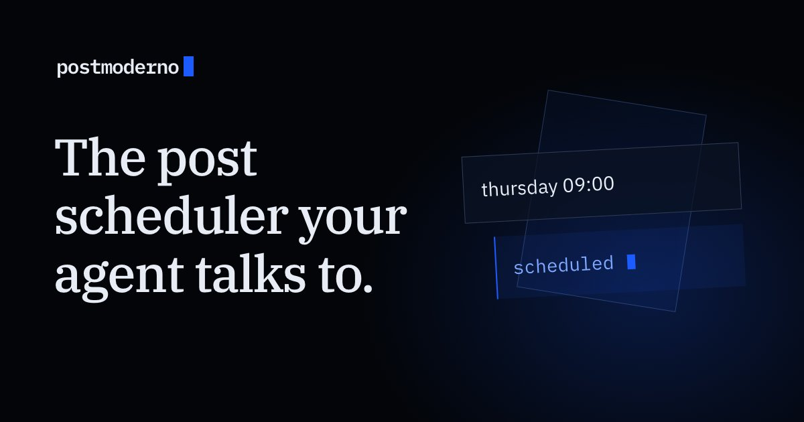

[**Start free**](https://postmoderno.io) · [Connect your agent](https://postmoderno.io/blog/schedule-posts-from-chatgpt-or-claude) · [Pricing](https://postmoderno.io/pricing) · [Status](https://postmoderno.uptimepage.dev/)

---

Postmoderno is a social media scheduler you run by talking to your AI agent. Tell ChatGPT, Claude, Claude Code, Cursor or any MCP client what to post and when. It publishes on time to Bluesky, Mastodon, X and LinkedIn.

## How it works

1. **Connect.** Add Postmoderno from [Claude's directory](https://claude.ai/directory/postmoderno), or point any MCP client at `https://mcp.postmoderno.io/mcp`.
2. **Draft where you already are.** There is no compose box. Your agent shows you the post and the time, then waits for your yes.
3. **Check the time.** You see your local time and UTC before anything is scheduled.
4. **Let it publish.** If a platform has a bad moment, Postmoderno retries on its own and shows you what happened, per platform.

## Free skills

[postmoderno-skills](https://github.com/postmoderno/postmoderno-skills) helps agents write X and LinkedIn posts grounded in platform ranking evidence, then schedule them with Postmoderno. MIT licensed, and each skill works on its own.

## Learn more

- [What is an MCP post scheduler?](https://postmoderno.io/blog/what-is-an-mcp-post-scheduler)
- [Schedule posts from ChatGPT or Claude](https://postmoderno.io/blog/schedule-posts-from-chatgpt-or-claude)
- [Free tools](https://postmoderno.io/tools)
- [Blog](https://postmoderno.io/blog)

Questions: [hello@postmoderno.io](mailto:hello@postmoderno.io)
